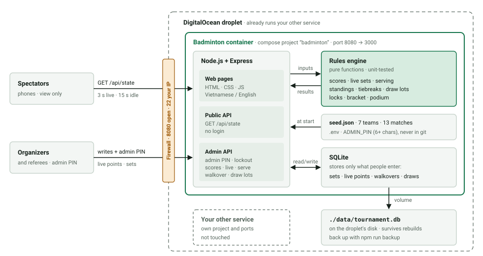
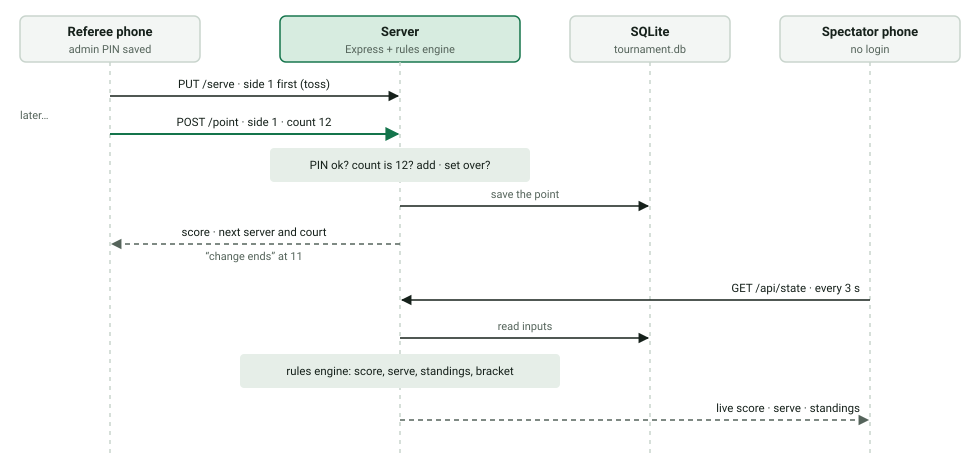
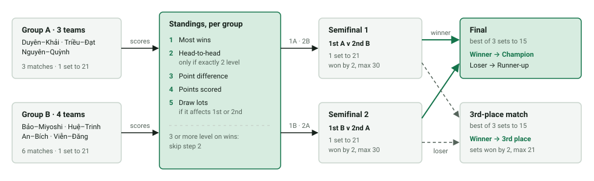
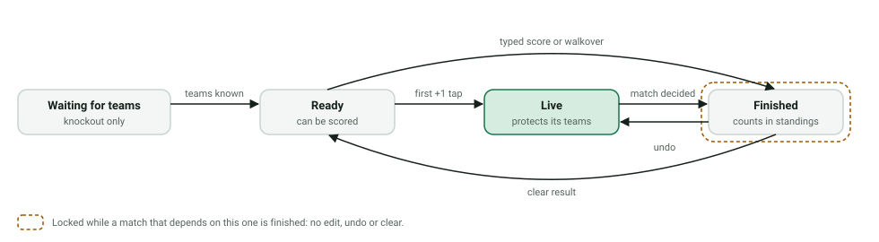

# Architecture

How the Trueson 1st Badminton Championship website is built, deployed and checked. What the app does, and every rule it follows, is in [SPEC.md](SPEC.md); this document covers the structure around that. Diagrams are SVG files in [diagrams/](diagrams/).

## 1. Overview



The app is one Docker container on the DigitalOcean droplet that already runs another service. Phones only ever talk to Express. Express loads the team list when it starts, keeps what people type in SQLite, and asks the rules engine to work out everything else on each request. The DigitalOcean Cloud Firewall leaves port 8080 open to everyone and SSH (22) open to your IP only. The other service keeps its own ports and its own compose project.

## 2. Components

| Part | Built with | Job |
|---|---|---|
| Web pages | Plain HTML, CSS, JS; no build step | Overview, groups, knockout, score entry; language switch remembered per browser. The browser loads the same `rules.js` (served at `/rules.js`) for the winner preview while a score is typed |
| Server | Node.js + Express | Serves the pages and the JSON API; checks the admin PIN and locks out repeated wrong guesses |
| Rules engine | One JS module, tested with `node --test` | Score validation, live sets and serving, standings, tiebreaks, locks, bracket, podium |
| Database | SQLite via better-sqlite3 | One file; holds only what people enter |
| Config | `server/seed.json`, `.env` | Teams, groups and match order from the spreadsheet; the admin PIN |
| Container | Docker + docker compose | Port 8080 → 3000, data folder mounted from the droplet, restarts after reboots |
| Page checks | Playwright, dev-only | Plays a tournament in a phone-sized browser; never in the Docker image |

## 3. Data

Only what people enter is stored. Everything else is computed on every request, so the standings can never disagree with the scores. With 13 matches the recalculation takes well under a millisecond.

| Saved in the database | Worked out on every request |
|---|---|
| Typed set scores | Match winner, state and lock |
| Live data: who served first, the point list | Live score, serving side and court |
| Walkover winners | Wins, PF, PA, PD, tiebreaks, ranks |
| Draw-lot order for a tied group | Qualifiers, knockout pairings, podium, progress |

```sql
CREATE TABLE results (
  match_id   TEXT PRIMARY KEY,   -- G1…G9, SF1, SF2, THIRD, FINAL
  kind       TEXT NOT NULL CHECK (kind IN ('sets', 'live', 'walkover')),
  data       TEXT NOT NULL,      -- JSON, shapes below
  updated_at TEXT NOT NULL       -- server time; rules.js never reads it
);

CREATE TABLE draws (
  group_id   TEXT PRIMARY KEY,   -- 'A' or 'B'
  team_codes TEXT NOT NULL,      -- JSON array in drawn order
  updated_at TEXT NOT NULL
);
```

| `kind` | `data` |
|---|---|
| `sets` | `{"sets": [[21, 17]]}` or `{"sets": [[15, 12], [13, 15], [16, 14]]}` |
| `live` | `{"firstServer": 1, "points": [1, 1, 2, 1]}`, where each entry is the side that won the rally |
| `walkover` | `{"winner": 2}` |

Sides are 1 and 2: team1 and team2 of the match as listed in `seed.json`. A match has at most one row, so typed sets, live data and a walkover replace each other (SPEC §5).

## 4. Request flows

### 4.1 One live point



Each tap is one request and is saved straight away, so a refreshed or replaced referee phone carries on from the server's score. The request carries the point count the screen shows. Express checks it and writes in one SQLite transaction; better-sqlite3 is synchronous and there is one Node process, so two taps can never interleave. If the count doesn't match, because of a retry or a second phone, the server answers 409 with the current state and the screen reloads.

### 4.2 Every other change

Typed scores, walkovers, serve changes, clearing and draws are each one request:

1. Check the PIN and the lockout (SPEC §9).
2. Compute the state with the change applied and compare it with the current state. Refuse if the match is locked, or if a live knockout match would get different teams (SPEC §7).
3. Validate the score (SPEC §4).
4. Write, then return the new state.

### 4.3 Spectators

Pages poll `GET /api/state` every 3 s while any match is live, every 15 s otherwise, and only while the tab is visible. The response is the whole computed tournament, a few kilobytes.

## 5. Tournament flow



Each group plays a round robin and is ranked by the five steps in order. The knockout matches fill in once both groups are complete. Details: SPEC §6–§8.

## 6. Match states



Group matches start at Ready; knockout matches wait until the earlier round decides who plays. While a match is Live, it protects its own teams: changes upstream are refused only if they would change who is playing. Once it is Finished, everything it depends on is locked until it is cleared or undone.

## 7. Folder layout

```text
badminton/
├── CLAUDE.md               guidelines + project section
├── docs/
│   ├── SPEC.md             rules and decisions
│   ├── ARCHITECTURE.md     this file
│   ├── diagrams/           SVG diagrams
│   ├── Điều lệ giải.pdf    original rules (Vietnamese)
│   └── Giai_cau_long_doi_nam_nu_7_doi.xlsx   original teams and match order
├── icons/                  original logos: Trueson and the sponsors (full size, not served)
├── server/
│   ├── index.js            Express: pages, API, PIN check, lockout
│   ├── db.js               SQLite setup and queries
│   ├── rules.js            rules engine (pure)
│   ├── rules.test.js       node --test, one test per SPEC rule and example
│   ├── backup.js           safe copy of the database
│   └── seed.json           7 teams, 13 matches
├── public/
│   ├── index.html
│   ├── app.js
│   ├── i18n.js             every string, vi + en
│   ├── logo.png            small copy of icons/TS_logo.png for the header
│   ├── sponsors.js         sponsor names and logos, in display order
│   ├── sponsors/           small web copies of the sponsors' logos
│   └── styles.css          brand colours in the first block
├── tests/ui/               Playwright checks (dev-only), run in name order against server.js (an empty app):
│   ├── features.spec.js    logo link, sponsor links, draws, locks, a refused correction, a live best of 3
│   ├── responsive.spec.js  every page at 17 sizes, upright and sideways, in both languages
│   └── tournament.spec.js  a whole tournament on a phone, sideways live scoring, sponsors, clear all
├── playwright.config.js    phone-sized Chromium, port 3100
├── Dockerfile
├── docker-compose.yml
├── .env.example            ADMIN_PIN=
├── .gitignore, .dockerignore
└── README.md               run, deploy, back up
```

## 8. Deployment

### Compose file

```yaml
name: badminton
services:
  app:
    build: .
    ports: ["8080:3000"]
    env_file: .env
    volumes: ["./data:/app/data"]
    restart: unless-stopped
```

- The image installs production dependencies only (`npm ci --omit=dev`), so Playwright stays out.
- `ADMIN_PIN` lives in `.env` on the droplet and never in git. The server won't start without a PIN of at least 6 characters.

### First deploy

1. **Check the droplet:** `docker ps`, `sudo ss -tlnp` and `free -h`. Port 8080 must be free. If less than about 200 MB of memory is free, add a 1 GB swap file.
2. **Check the office network:** run `docker run --rm -p 8080:80 nginx` on the droplet and open `http://<droplet-ip>:8080` on the office Wi-Fi. Stop it with Ctrl+C.
3. **Firewall:** in the DigitalOcean Cloud Firewall, allow inbound 8080 from anywhere and 22 from your IP. Ports that Docker publishes ignore `ufw`, so this firewall is what controls access.
4. **Copy the code** from your computer:
   `rsync -av --exclude node_modules --exclude data --exclude .env ./ <user>@<droplet-ip>:/opt/badminton/`
5. **Start it** on the droplet: create `/opt/badminton/.env` containing `ADMIN_PIN=…`, then run `cd /opt/badminton && docker compose up -d --build`.
6. **Open it:** load `http://<droplet-ip>:8080` on your phone. If Chrome warns that the connection isn't secure, tap “Continue to site” (SPEC D14).

### Update

Repeat step 4, then `docker compose up -d --build`. The data in `./data` is kept.

### Backup, restore, reset

- **Backup:** `docker compose exec app npm run backup` writes `data/backup-<UTC date and time>.db`, for example `backup-2026-11-03T0718.db`, using SQLite's own backup, which is safe while the app runs. Then copy it off the droplet: `scp <user>@<droplet-ip>:/opt/badminton/data/backup-*.db .`
- **Restore:** `docker compose down`, copy the backup over `data/tournament.db`, then `docker compose up -d`.
- **Reset after the rehearsal:** use “Xóa toàn bộ kết quả” (Clear all results) at the bottom of the admin page. It asks for the PIN again and saves `data/backup-before-clear-<UTC date and time>.db` first (SPEC §5.5).

### Never on this droplet

Don't run `docker system prune` in any form, and don't run `docker compose down` outside `/opt/badminton`. Both can remove the other service's containers, images or data.

## 9. Build plan

| # | Step | Done when |
|---|---|---|
| 1 | **Project setup:** CLAUDE.md section, SPEC.md, seed.json, this file, git and `.gitignore` | SPEC.md has been read against the rules PDF |
| 2 | **Rules engine and tests:** score validation, live sets and serving, standings and tiebreaks, walkovers, locks, bracket, podium | `npm test` passes for every rule and every example in SPEC §6.4–§6.5 |
| 3 | **Database and API:** both tables, nine endpoints, PIN check and lockout, lock and pairing checks, point counts | A whole tournament entered through the API gives the expected podium; a late group correction and a duplicate tap are both refused |
| 4 | **Web pages:** overview, groups, knockout, score entry (typed, live with serve and Undo, walkover), language switch, refresh | `npm run test:ui` plays a full tournament on a phone-sized screen in both languages, with one match scored live |
| 5 | **Docker and README:** Dockerfile, compose file, `.env.example`, run/deploy/backup steps | `docker compose up -d --build` works from a clean checkout, and the data survives a rebuild |
| 6 | **Droplet and network check:** deploy steps 1–3 | Port 8080 is free, memory is enough, and the test page loads on office Wi-Fi |
| 7 | **Deploy:** deploy steps 4–6 | The site loads on your phone, and an organizer can log in with a PIN of 6+ characters |
| 8 | **Rehearse, then reset:** organizers enter a fake tournament with one live match, then the database is reset and backed up | The app is empty, a backup exists, and every organizer knows the PIN |

## 10. Risks

| Impact | Issue | What we do |
|---|---|---|
| High | Chrome warns before the first visit to a public HTTP site | Accepted (SPEC D14). People tap “Continue to site” once, and Chrome stops asking for sites they visit often. |
| High | Office Wi-Fi may block port 8080 | Test it in deploy step 2. If it's blocked: mobile data, or route `/badminton` through the other service's proxy on port 80. |
| High | Cleanup commands hit the other service | Separate compose project named `badminton`. README and CLAUDE.md forbid `prune`. Claude doesn't run commands on the droplet. |
| Medium | Venue Wi-Fi drops during live scoring | Each tap shows whether it was saved and retries safely thanks to the point count. The final score can always be typed afterwards. |
| Medium | Docker-published ports ignore `ufw` | Access is controlled with the DigitalOcean Cloud Firewall. |
| Medium | Not enough memory on a shared 512 MB droplet | Check with `free -h`; add swap. The app needs under 100 MB. |
| Medium | Losing the database | `npm run backup` after each match day, copied off the droplet; DigitalOcean droplet backups as a second copy. |
| Low | Someone guesses the PIN | 6+ characters, plus a 15-minute lockout after 10 wrong tries (SPEC §9). |
| Low | The lockout hits the venue's shared Wi-Fi address | Restart the container to clear it, or switch to mobile data. |
| Low | PIN sent unencrypted over HTTP | Use a PIN that isn't used anywhere else, and change it after the event. |
| Low | Two phones scoring one match | The second phone's out-of-date tap is refused, and the phone reloads. |
| Low | An exact tie holds up the semifinals | The app names the tied teams; organizers draw at the venue and enter the order. |
| Low | The old spreadsheet disagrees with the app | It rejects the legal scores 30–28 and 21–19. The app is the official record. |
| Low | A string missing in one language | One file per language, and a test checks both have the same keys. |
| Low | Player names visible on a public address | Pages ask search engines not to index them. |
| Low | Port 8080 already taken | Change one line in `docker-compose.yml`, plus the firewall rule. |
| Low | A player is substituted | Edit `seed.json` and redeploy. Results are keyed by team code. |

## 11. Working with Claude

- One build step per request, such as “do step 2”. Smaller diffs are easier to review.
- For anything in `rules.js`, ask for the plan first, then the code.
- When a rule looks wrong, point at the SPEC section instead of restating it.
- Change a decision in SPEC §12 first, then the sections it affects.
- Run `/code-review` before each deploy.
